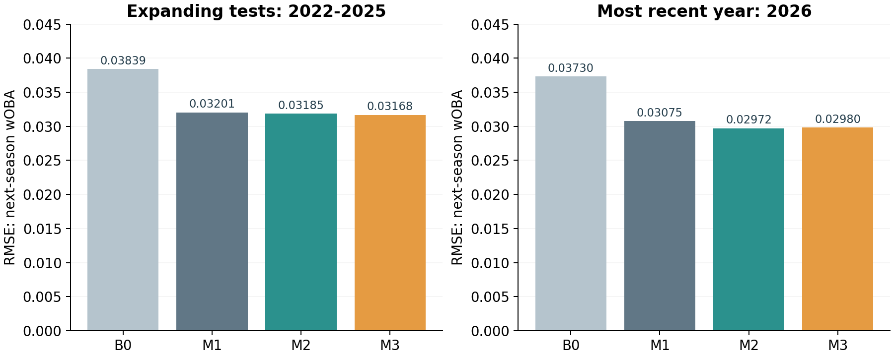

# Signals for Next Season — MLB Hitter Analysis

**Do richer performance signals improve forecasts enough to justify changing a scouting process?**

I compare traditional batting information with Statcast skill levels and annual changes, then evaluate a separate signal-screen policy under a fixed number of player-review slots. My main finding is that **better prediction and better selection are different claims**: M2 had the lowest 2026 forecast error, while the screen followed by M1 ranking did not improve historical growth yield over M1-only selection.

[Technical report (PDF)](reports/Signals_for_Next_Season_2027_Report_EN_Corrected.pdf) · [Executed notebook](notebooks/Signals_for_Next_Season_2027.ipynb) · [My interpretation](docs/PROJECT_GUIDE.md) · [Results](reports/model_metrics.csv)

## My project in plain English

I asked two related questions: **can I predict a hitter's next season more accurately, and can I use those predictions to choose better players for limited scouting review?**

- **What I built:** I compared models using traditional batting statistics, Statcast skill measurements and year-to-year skill changes. I then evaluated a separate screening rule for allocating player-review slots.
- **How I evaluated it:** I trained on earlier seasons, evaluated later seasons and compared selection policies with the same eligible players and number of review slots within each policy.
- **What I learned:** I found that adding current skill measurements improved 2026 prediction error, while my signal screen selected fewer growth successes than ranking with M1 alone. I therefore separate my forecasting result from my scouting-policy result.

I predict **wOBA**, a batting measure that weights offensive outcomes; higher values indicate stronger production. I use **RMSE** to summarize prediction error, where lower is better, and **PA** for plate appearances. I have preserved my 2027 forecasts for future evaluation; I do not yet have 2027 outcomes.

## What I found

| Model | Inputs | 2022–2025 RMSE · 889 observations | 2026 RMSE · 229 observations |
|---|---:|---:|---:|
| B0 · Carry current wOBA forward | 1 | 0.03839 | 0.03730 |
| M1 · Traditional information | 9 | 0.03201 | 0.03075 |
| M2 · Add current skill levels | 15 | 0.03185 | **0.02972** |
| M3 · Add annual skill changes | 21 | **0.03168** | 0.02980 |

M3 improves pooled development RMSE, but improves on M2 in only two of four development years and slightly worsens 2026 RMSE. I retained M1 as my operational reference after reviewing historical results. This was a retrospective, rule-dependent choice—not evidence that M1 was the most accurate model. The tiny development MAE difference between M1 and M2 does not establish meaningful superiority.



## Did the signal screen help the decision?

| Exploratory policy | Screen → M1 growth successes | M1-only growth successes | Random expected successes |
|---|---:|---:|---:|
| Original policy | 7 / 53 slots | 13 / 53 slots | 11.20 |
| Revised policy | 2 / 22 slots | 7 / 22 slots | 5.18 |

Within each policy and season, I hold the eligible pool and review-slot count constant across alternatives. The policies themselves use different pools and budgets. Growth means next-season PA ≥200 and wOBA improvement ≥.020. Slots are player-season review opportunities, not unique-player totals or financial budgets.

Both screen → M1 and M1-only rank using M1 forecasts. This comparison evaluates the screen, not an M1-to-M2/M3 replacement. I keep the separate [Top-15 model-ranking analysis](reports/decision_backtest.csv) and retention AUC results distinct from growth yield.

## My approach

- I use 2015–2026 annual MLB/Savant snapshots, expanding target-year validation and training-only imputation and scaling.
- I compare a carry-forward baseline and three Ridge specifications with fixed alpha 10.
- I examine forecast errors, repeated-player uncertainty, outcome-definition sensitivity and equal-budget policy outcomes.
- I preserve 298 forecasts and evaluation definitions for the future 2027 season. Outcomes are **pending**.

This connects my interest in baseball to business analytics: I want to understand when additional information changes a decision enough to justify a more complex process.

## My next validation step

After the complete 2027 season, I plan to evaluate my preserved forecasts using the recorded protocol without refitting. I will report forecast error and selection outcomes separately and retain the limits of my exploratory historical comparisons.

## Inspect the evidence

| File | What I use it for |
|---|---|
| [My project guide](docs/PROJECT_GUIDE.md) | Current interpretation, analytical choices and limits |
| [Forecast metrics](reports/model_metrics.csv) | Model errors at full precision |
| [Policy summary](reports/scouting_policy_summary.csv) | Historical policy totals |
| [Paired AUC intervals](reports/paired_auc_intervals.csv) | Retention-discrimination comparisons |
| [Random benchmark](supplement/random_growth_benchmark.csv) | Random-selection comparison |
| [Main implementation](src/study.py) | Forecasting pipeline |
| [Robustness implementation](src/robustness.py) | Sensitivity and policy evaluation |
| [2027 evaluation lock](reports/2027_evaluation_lock.json) | Original frozen evaluation record |
| [2027 protocol](docs/PROSPECTIVE_2027_PROTOCOL.md) | Recorded future evaluation definitions |

The corrected PDF and HTML preserve the archived technical presentation. Download the repository and open the HTML locally; GitHub's HTML view shows source. The notebook includes an embedded processed snapshot and visible outputs.

## Verify and reproduce

Python 3.11+:

```bash
python scripts/verify_snapshot.py
python -m pip install -r requirements.txt
python -m src.review_verification
```

The first command uses only the standard library to verify frozen files, 41 cached sources, forecast metrics and policy counts. The review command recomputes diagnostics without network access and writes to `supplement/`.

For a full model rebuild, **work in a copy**:

```bash
python -m src.study
python -m src.revision
```

These commands write outputs and may alter creation metadata. They should not replace the original frozen archive. The notebook provides a self-contained execution route. I preserve the supplied notebook outputs; GitHub preparation does not claim a fresh full notebook execution.

After the complete 2027 regular season, supply official totals with columns `player_id,season,pa,woba`:

```bash
python -m src.evaluate_2027 --outcomes official_2027.csv --season-complete --source "official source description" --output evaluation_2027
```

I have not run this against future outcomes. The evaluator checks frozen hashes and does not refit models. Its recorded date is an internal project record, not externally authenticated preregistration.

## Scope

Historical comparisons are exploratory: 2026 outcomes were reused during analysis and selection. Forecast accuracy, retention AUC, growth yield and practical utility answer different questions. Annual data do not establish early within-season detection, causal skill development, market undervaluation or acquisition ROI. I did not implement a stronger Marcel-style multiyear baseline.

Eight unresolved individual ±1 PA differences remain between cached 2026 sources; none changes eligibility. Some historical presentation scripts reference modules absent from the supplied archive. I include finished reports without claiming every historical layout can be regenerated. See [my guide](docs/PROJECT_GUIDE.md).

## Sources

I use official [Baseball Savant leaderboards](https://baseballsavant.mlb.com/leaderboard/custom) and [MLB Stats API](https://statsapi.mlb.com/api/). Source URLs, retrieval timestamps and SHA-256 metadata accompany the cached files in `data/raw/`. Third-party data and fonts retain their respective rights; I do not relicense MLB data. This independent project does not imply affiliation with MLB or a team.

## AI-assisted development

I used AI tools to support project development, including code and documentation. I take responsibility for the analytical choices and interpretations presented here, and I document the data, comparisons, assumptions and limitations behind my conclusions. I distinguish AI assistance during development from the models I actually implement; I describe those models in the methods rather than imply that I built an LLM-based system.
